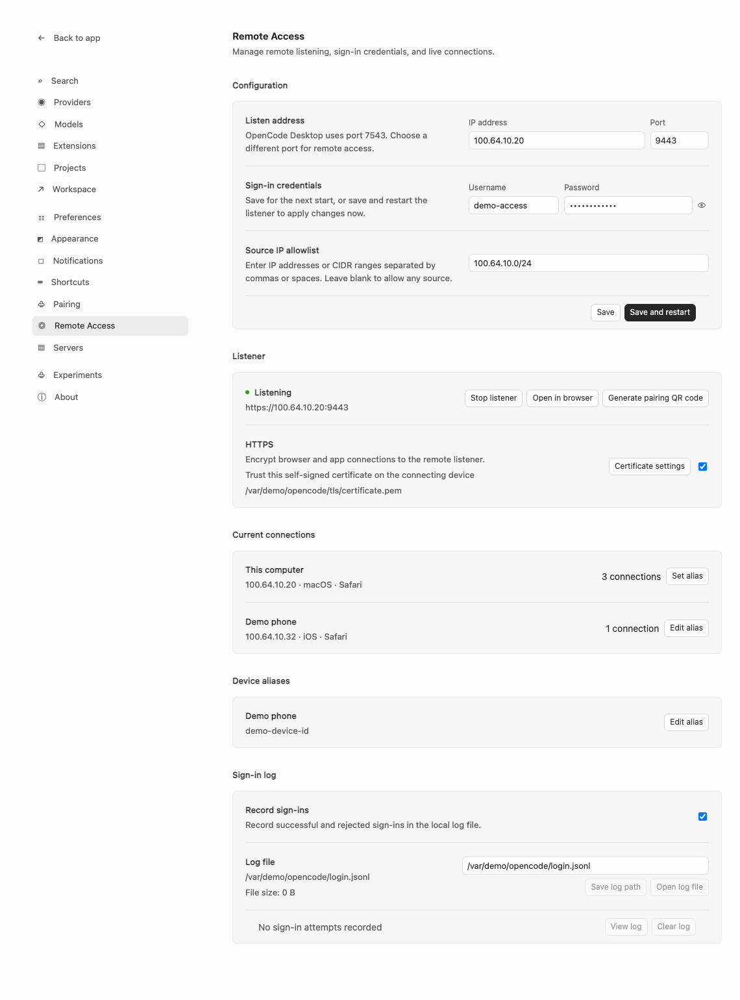

# OpenCode Remote Access

[简体中文](README.md) · **English**

[](https://opencode.ai/docs/cli/plugins/)
[](LICENSE)
[](https://github.com/fangfengxiang/opencode-remote-access/stargazers)

**Requires OpenCode Desktop v2 with GUI plugin support.**

Open **OpenCode Desktop → Settings → Remote Access** to manage the listener, sign-in credentials, and connected devices. The plugin provides HTTP or HTTPS access to the OpenCode web interface, with password sign-in, one-time pairing, and a sign-in log. Its native settings page follows the Desktop language and supports Simplified Chinese, Traditional Chinese, English, and Russian.



## Install and update

Use an OpenCode Desktop release that supports GUI plugins. After installing, open the app and go to **Settings → Remote Access**.

```bash
opencode plugin add github:fangfengxiang/opencode-remote-access
```

On OpenCode v2.3.0, running the update command without arguments updates all eligible plugins.

```bash
opencode plugin update
```

When switching from a local development checkout to a GitHub installation, remove the local directory entry from OpenCode's global plugin configuration first.

## Use the listener

1. Choose an IPv4 address assigned to this computer that your devices can reach. On Tailscale, run `tailscale ip -4` to find it.
2. Set a listener port, username, and password. Pick a port different from the local OpenCode service port.
3. Optionally configure the **Source IP allowlist**. Enter IP addresses or CIDR ranges separated by commas or spaces. Leave it blank to allow any source. The same rules apply to local browser connections.
4. Click **Save**, then **Start listener**. While it is running, **Save** applies the settings on the next start and **Save and restart** applies them immediately.
5. Click **Open in browser** to sign in automatically using a one-time link, or generate a QR code for another device. Camera mode encodes a browser link and OpenCode App mode uses the native pairing format. Pairing links expire after five minutes.

Restarting the remote listener expires its paired sessions. Desktop runs on its own local service. Listener settings are stored in `~/.opencode/remote.json` under the current user's home directory.

## HTTPS

Turn on **HTTPS** in the **Listener** section. An active listener restarts and the browser button and pairing links use HTTPS.

- **Generated certificate.** Leave the certificate and private key paths blank. The plugin uses OpenSSL from the system PATH to generate a self-signed certificate. The settings page shows the public certificate path. The connecting device needs to trust that certificate.
- **Your certificate.** In **Certificate settings**, choose a PEM certificate and its matching unencrypted PEM private key. The certificate file may include the full chain. Use a certificate that covers the listening IP, or enter a hostname covered by the certificate and resolve it to the listener IP.
- **Listener address.** HTTPS uses the configured IP and port. Use the URL shown after switching.

OpenCode v2.3.0 serves the local web interface through `opencode serve`. The plugin handles TLS at the remote listener. [OpenCode Web documentation](https://opencode.ai/docs/cli/web)

## Connections and logs

- **Current connections** shows source IPs and available device details. Traffic from this computer is labeled **This computer**. Device model details depend on the client. Create and edit aliases from connections, sign-in records, or the device aliases section.
- The **Sign-in log** defaults to the relative filename `login.jsonl` in the plugin's per-user data directory. Settings shows the resolved absolute path and file size. A custom log file path is absolute.
- View entries, open the file, change the path, disable recording, or clear the log. The view and clear buttons are disabled when the log is empty.
- The log keeps the latest 500 records. Requests denied by the allowlist appear as **Blocked**.

## Desktop compatibility

| Environment | Verification |
| --- | --- |
| macOS | Plugin loading and the web listener were verified on OpenCode Desktop v2.3.0. |
| Ubuntu | Use the OpenCode Desktop Linux build with GUI plugin support. The gateway, TLS, and log tests passed in an Ubuntu 24.04 LTS container. Linux Desktop GUI testing is pending. |
| Windows | The Desktop features use cross-platform Electron and Node.js APIs. Native Windows Desktop has yet to be tested. |

Certificate generation requires OpenSSL on PATH. If you provide PEM files, Node.js loads them directly.

[Official OpenCode Desktop downloads](https://opencode.ai/docs#desktop)

## Optional terminal commands

On macOS and Linux, the installer can add `oc-listen` and `oc-qr`. It requires Python 3.8 or later.

```bash
git clone https://github.com/fangfengxiang/opencode-remote-access.git
cd opencode-remote-access
./install.sh --commands-only
```

Add `~/.opencode/bin` to `PATH`. The shortcuts talk to the running Desktop app through a Unix socket. On Windows, use Desktop settings to control the listener and pairing.

## Documentation and development

- [Features](docs/en/features.md)
- [Design](docs/en/design.md)
- [MIT License](LICENSE)
- [Third-party component](docs/en/third-party.md)
- [Community and related projects](docs/en/community.md)

```bash
node scripts/build.cjs
node scripts/build.cjs --check
npm test
```

For local development, `./install.sh` registers the checkout. Ship both `src/` and the prebuilt `gui-experimental.cjs` in releases.

## Authors

[fangfengxiang](https://github.com/fangfengxiang) · Codex

[AI documentation index](llms.txt)
