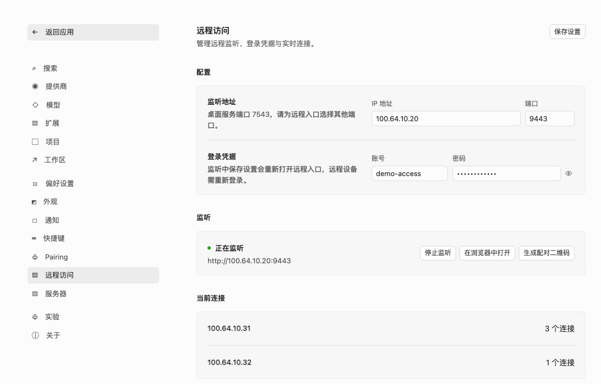

# OpenCode 远程访问

在 **OpenCode Desktop → 设置 → 远程访问**中配置监听地址、端口和远程登录凭据。远程设备可以用账号密码登录，也可以用一次性配对链接和二维码接入。页面会显示监听状态及当前来源 IP。远程 Web 入口使用 HTTP，适合通过 Tailscale 等加密私网访问。



## 安装

在支持桌面 GUI 插件的 OpenCode 上运行：

```bash
opencode plugin add github:fangfengxiang/opencode-remote-access
```

重新打开 OpenCode Desktop，在 **设置 → 远程访问**中找到插件。OpenCode 加载仓库自带的 CommonJS 文件。

更新 GitHub 安装：

```bash
opencode plugin update github:fangfengxiang/opencode-remote-access
```

如果以前通过本地目录安装过，可以从 OpenCode 全局配置的 `plugins` 数组移除旧目录条目，再运行原生安装命令。

## 使用

1. 在 Mac 上连接远程设备将使用的网络。使用 Tailscale 时，可用 `tailscale ip -4` 查看当前机器的 IPv4 地址。
2. 填写监听 IP、端口和远程账号密码，保存设置。监听 IP 使用本机分配的具体地址，端口需与页面提示的 OpenCode 本机服务端口不同。
3. 启动监听。点 **在浏览器中打开**可测试当前 HTTP 入口，也可以在其他能访问该地址的设备上打开同一个 URL。
4. 用设置页配置的账号密码登录，或生成一次性配对链接和二维码。

修改账号、密码、IP 或端口后，插件会按新配置重新监听。此前通过插件配对的设备需用新凭据登录或重新配对。

配置保存在 `~/.opencode/remote.json`，含监听地址、端口、用户名和密码。这个文件包含明文密码，请保留用户专用访问权限。

## 可选终端命令

如果也想通过终端控制监听，可下载快捷命令。安装脚本使用 Python 3.8 或更新版本。

```bash
git clone https://github.com/fangfengxiang/opencode-remote-access.git
cd opencode-remote-access
./install.sh --commands-only
```

将 `~/.opencode/bin` 加入 `PATH`。运行 `oc-listen` 控制监听和查看登录信息，运行 `oc-qr` 生成配对信息。使用这些命令时需保持 OpenCode Desktop 开启。

## 文档与开发

- [支持的功能](docs/features.md)
- [设计文档](docs/design.md)

修改源代码后生成并校验桌面入口：

```bash
node scripts/build.cjs
node scripts/build.cjs --check
npm test
```

本地开发可在源码目录执行 `./install.sh` 注册当前目录。发布时提交 `src/` 和生成的 `gui-experimental.cjs`。
